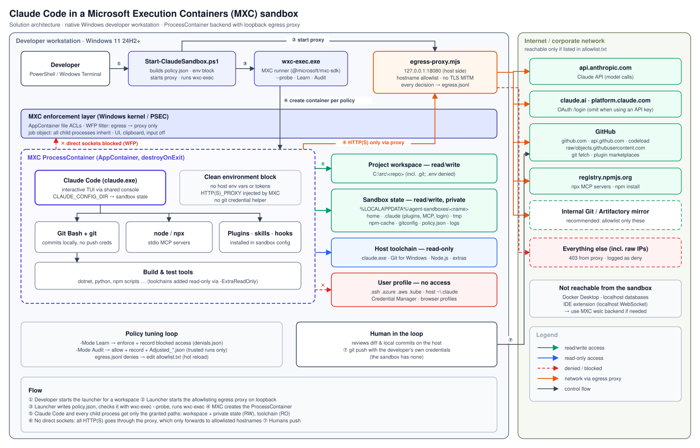

# agent-sandboxing

Isolating AI coding agents (Claude Code and others) on **native Windows developer machines** with
**Microsoft Execution Containers (MXC)**, Microsoft's policy-driven containment for AI agents on Windows 11.

## What's in here

| Path | Content |
|---|---|
| [`sandbox/`](sandbox/) | Working example: Claude Code inside an MXC **ProcessContainer** with git, Git Bash, Node/npx, plugins and MCP servers, plus an allowlisting egress proxy |
| [`sandbox/Start-ClaudeSandbox.ps1`](sandbox/Start-ClaudeSandbox.ps1) | Launcher: builds the MXC policy, starts the proxy and runs `wxc-exec.exe`. Modes: Enforce, Learn, Audit |
| [`sandbox/egress-proxy.mjs`](sandbox/egress-proxy.mjs) | Dependency-free loopback HTTP/HTTPS proxy with a hostname allowlist and JSON-lines decision log |
| [`sandbox/allowlist.txt`](sandbox/allowlist.txt) | Starter egress allowlist (Anthropic API/login, GitHub, npm) |
| [`sandbox/example-policy.json`](sandbox/example-policy.json) | Example policy as generated, checked against the MXC `1.0.0` schema |
| [`docs/architecture/`](docs/architecture/) | Solution architecture as SVG and editable draw.io, plus the Python generator for both |

## Approach in one paragraph

Claude Code runs inside an AppContainer-based MXC ProcessContainer. It gets read/write access only to the
project folder and a private per-sandbox state folder (home, `CLAUDE_CONFIG_DIR`, temp, npm cache).
The toolchain is read-only, and the real user profile (SSH keys, cloud credentials, browser profiles) can't
be reached. The sandbox gets a clean environment block with no host tokens, and no git credentials, so humans push.
Direct network sockets are blocked by WFP. All HTTP(S) goes through a loopback proxy that forwards only
to allowlisted hostnames and logs every decision.

## Requirements

- Windows 11 24H2/25H2 with the Aug 2026 update (build 26100.9278 / 26200.9278) or newer
- Claude Code (native installer), Git for Windows and Node.js on the host
- `npm install @microsoft/mxc-sdk` in `sandbox/` (provides `wxc-exec.exe`)

See [`sandbox/README.md`](sandbox/README.md) for usage, policy tuning and known limits.

## Background

- Unsloth's "high" sandbox mode on Windows is built on MXC as well. MXC is the reusable building block
  that works with any agent.
- Native MXC support has been announced for Claude Code. Once it ships, prefer it over this wrapper.

## References

- [microsoft/mxc](https://github.com/microsoft/mxc): SDK, schemas, samples
- [Microsoft Execution Containers: policy-driven containment for AI agents (Windows Blog)](https://blogs.windows.com/windows/2026/10/07/microsoft-execution-containers-policy-driven-containment-for-ai-agents/)
- [Sandboxing in Unsloth](https://unsloth.ai/docs/new/studio/sandboxing-in-unsloth)

> Status: example / reference implementation. It hasn't been tested end to end on an MXC-enabled host yet.
